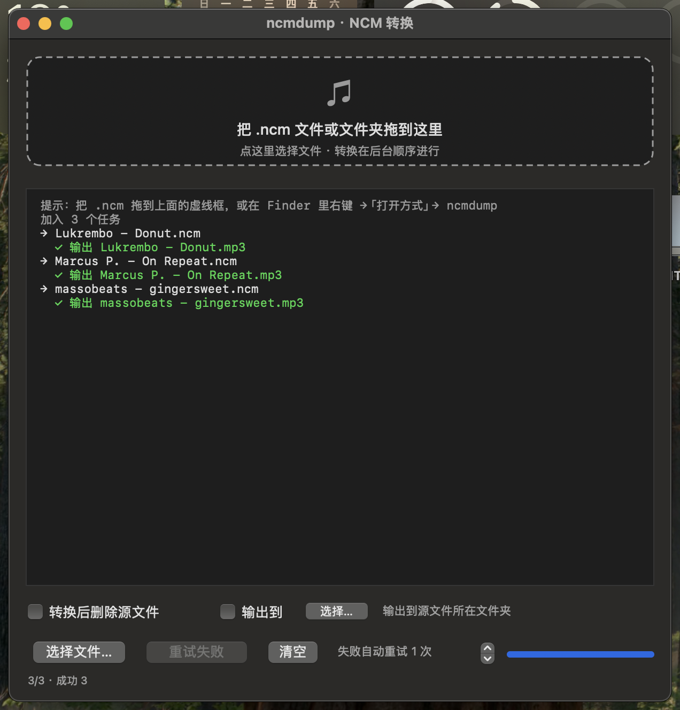

# ncmdump GUI

[](https://github.com/delete-rm/ncmdump-gui/releases/latest)
[](https://github.com/delete-rm/ncmdump-gui/actions)
[](LICENSE)

macOS 上把网易云音乐 `.ncm` 批量转成 `mp3` / `flac` 的原生图形界面，单文件 Objective-C + AppKit，无第三方运行时依赖。

内核是 [taurusxin/ncmdump](https://github.com/taurusxin/ncmdump) 1.5.0（静态版，已内置），本仓库只负责界面、队列、重试与安全删源。



## 功能

- 拖拽 `.ncm` 文件或文件夹到窗口即排队转换，文件夹会递归子目录
- Finder 右键「打开方式」→ ncmdump；双击 `.ncm` 也能冷启动并立刻开始转换
- **转换后删除源文件**（默认关闭，且仅在确认产出文件后才删）
- 自选输出目录（默认输出到源文件同目录），**并保留拖入文件夹的子目录结构**
- 失败自动重试 0–5 次，另有「重试失败 (N)」按钮手动重跑
- 批量进度条 + 逐条日志 + `转换中 / 已处理 / 成功 / 失败 / 队列` 状态统计
- 整批完成时播放提示音，窗口在后台会弹 Dock 图标
- 日志同时落盘到 `~/Library/Logs/ncmdump-gui.log`（超过 4 MB 自动清空）
- 记住窗口尺寸
- 设置通过 `NSUserDefaults` 持久化（域：`local.ncmdump.gui`）
- universal2（arm64 + x86_64），内置的 ncmdump 同样是 universal

## 系统要求

- macOS 12.0 及以上（已在 macOS 15.8 / Apple Silicon 实机验证；Intel 与 Apple Silicon 均可运行）
- 构建需要 Xcode Command Line Tools：`xcode-select --install`，不需要完整 Xcode

## 安装

**方式一：下载 Release 里的 `ncmdump.app.zip`**

解压后拖进「应用程序」。首次打开若被 Gatekeeper 拦截：右键 → 打开，或

```bash
xattr -dr com.apple.quarantine /Applications/ncmdump.app
```

**方式二：自行构建**

```bash
git clone <this repo> && cd ncmdump-gui
./build.sh                 # 编译 + 打包 + 签名，装到 ~/Applications/ncmdump.app 并启动
./build.sh --no-launch     # 只构建，不自动启动
./build.sh /tmp/test.app   # 装到指定位置
./build.sh --zip           # 额外产出 build/ncmdump.app.zip，可直接传 Release
```

首次构建会从 GitHub 下载 ncmdump 1.5.0 的 arm64 与 x86_64 两个包并 `lipo` 合并成
universal，缓存在 `vendor/ncmdump`（该文件**不入库**）。之后构建直接复用，秒级完成。

网络不通时可以：

```bash
# 走镜像
NCM_URL_PREFIX=https://ghproxy.net/https://github.com/taurusxin/ncmdump/releases/download ./build.sh

# 或手动下载两个 tar.gz，解压后合并
lipo -create -output vendor/ncmdump <arm64>/ncmdump <x86_64>/ncmdump && chmod +x vendor/ncmdump
```

## 使用

1. 把 `.ncm` 拖进虚线框（或点它选文件 / 文件夹）
2. 需要的话先勾「转换后删除源文件」、勾「输出到」并选目录、调好重试次数
3. 结果写在目标目录，日志里显示 `✓ 输出 xxx.mp3`

命令行版可直接用 `vendor/ncmdump`：

```bash
./vendor/ncmdump -d ~/Music/网易云音乐 -r        # 递归转换整个目录
./vendor/ncmdump -o ~/Music/out song.ncm         # 指定输出目录
```

## 目录结构

```
main.m                  全部界面与逻辑（DropView / Controller / AppDelegate）
icon.m                  用 SF Symbol + 渐变生成图标，build.sh 里转成 .icns
vendor/ncmdump          ncmdump 1.5.0 内核（universal）—— 构建时自动下载，已 gitignore，不入库
vendor/ncmdump.LICENSE.txt   上游 MIT 许可证与来源说明（随仓库分发，构建时也拷进 App）
.github/workflows/      CI：push/PR 冒烟构建；推 v* 标签自动打包并发 Release
build.sh                编译（arm64 + x86_64 → lipo）+ 打包 + 签名 + 注册
docs/screenshot.png     界面截图
```

## 两个踩过的坑

**1. 不能拿退出码判断转换是否成功**

`ncmdump` 处理非法输入（例如把别的文件改名成 `.ncm`）时会打印

```
[Exception] Not netease protected file 'xxx.ncm'
```

但**退出码仍然是 0**。若按退出码判定，就会出现「报告成功 → 删掉源文件 → 实际什么都没生成」。

本程序的做法：转换前后比对目标目录，只有出现同名的**新** `.mp3` / `.flac` 才算成功；失败会走重试，并且绝不会删除源文件。

**2. 为什么内置 1.5.0 而不是最新的 1.5.1**

上游从 1.5.1 起 Release 不再提供静态链接版本（Windows 除外），macOS 包会动态链接
`/opt/homebrew/opt/taglib/lib/libtag.2.dylib`，且二进制造于 macOS 15.0。没有 Homebrew /
系统版本较低时会直接 `dyld: Library not loaded`。

1.5.0 的 darwin 包只依赖系统库，可直接运行；与 1.5.1 的功能差异只有一个 `-m`
（转换成功后删除源文件），而这个功能本程序自己实现得更安全（见上一条）。

## 已知限制

- 日志文件超过 4 MB 会被直接清空，不做归档
- 只支持 `.ncm`，不处理 qmc / mflac 等其它平台格式

## 自动发布

仓库带了 GitHub Actions：

- `.github/workflows/ci.yml` —— 每次 push / PR 在 macOS runner 上构建一次并做冒烟检查
- `.github/workflows/release.yml` —— 推一个 `v*` 标签，自动构建 universal2 包并挂到 Release

```bash
git tag v1.4 && git push origin v1.4
```

不用本地打包，也不用手动传 zip。构建脚本里的内核下载带 SHA256 校验，被篡改会直接失败。

## 第三方组件

| 组件 | 版本 | 许可证 | 说明 |
|---|---|---|---|
| [taurusxin/ncmdump](https://github.com/taurusxin/ncmdump) | 1.5.0 | MIT | 转换内核，以子进程方式调用，未修改代码。构建时从上游 Release 下载，仓库本身不包含该二进制 |

MIT 许可证全文见 `vendor/ncmdump.LICENSE.txt`（构建时也会拷进 App 的 Resources）。由于仓库不直接分发二进制，该文件主要用于说明依赖来源；Release 里的 `ncmdump.app.zip` 内含该许可证全文。上游 `LICENSE.txt` 的版权行是占位符
（`Copyright (c) [year] [fullname]`），此处按原样保留并注明来源。

## 免责声明

本项目仅用于**转换本人已购买/已下载的音乐文件**、以及学习 macOS 与音视频格式相关的编程技术。

- 请勿用于传播侵权内容或任何商业用途
- 请遵守网易云音乐的服务条款及你所在地区的法律法规
- 本项目与网易云音乐官方无关；使用本工具产生的任何后果由使用者自行承担

## 许可证

本项目代码以 [MIT](LICENSE) 发布。
